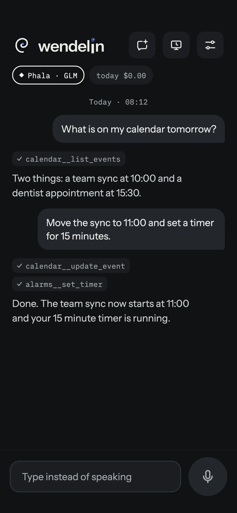
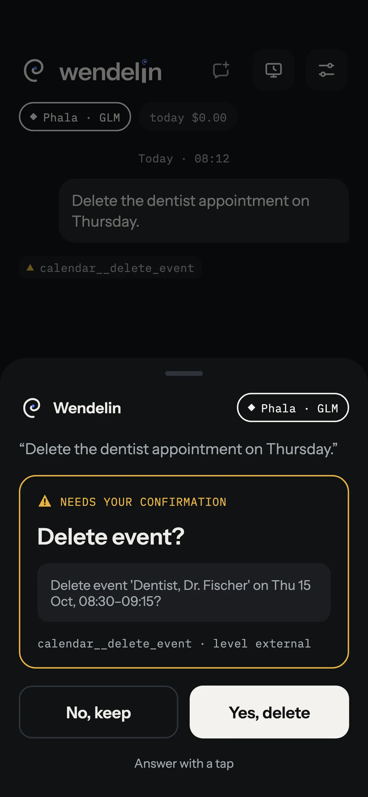
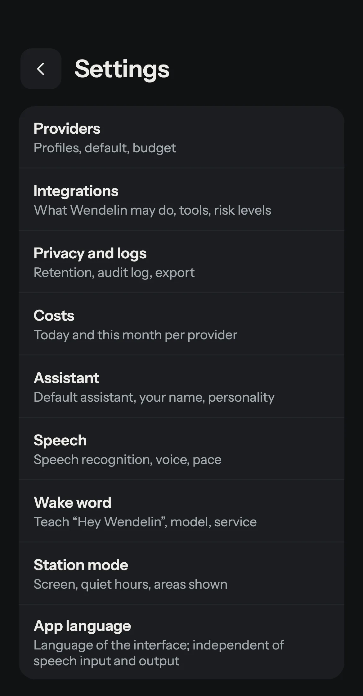

<!-- SPDX-License-Identifier: GPL-3.0-or-later -->
[English](README.md) · **Deutsch**

<div align="center">

<picture>
  <source media="(prefers-color-scheme: dark)" srcset="app/assets/logo/wendelin-lockup-on-dark.svg">
  
</picture>

**Ein persönlicher Sprachassistent für Android, der so viel wie möglich auf dem Handy erledigt: Weckwort, Spracherkennung und Sprachausgabe laufen lokal, das Sprachmodell wählst du selbst.**

[](https://github.com/brokoskokoli/wendelin/actions/workflows/gate.yml)
[](https://github.com/brokoskokoli/wendelin/releases)
[](LICENSE)
[](#installation)



[](https://github.com/brokoskokoli/wendelin/releases/latest)

[Webseite](https://brokoskokoli.github.io/wendelin/)

</div>

> **Status:** Version 0.1.0 ist die erste öffentliche Version. Siehe das [Änderungsprotokoll](CHANGELOG.md) (Englisch).

## Warum Wendelin?

Die meisten Sprachassistenten schicken deine Stimme in die Cloud eines anderen und sprechen nur mit den Diensten, die der Hersteller ausgesucht hat. Wendelin dreht das um: Es wird der Standard-Assistent deines Handys, versteht dich **auf dem Gerät**, und nur Text geht an ein **Sprachmodell deiner Wahl** (mit deinem eigenen API-Schlüssel, ohne Wendelin-Server). Bei Anbietern mit vertraulicher Ausführung (TEE) prüft Wendelin die Attestierung selbst, bevor es etwas sendet.

Es läuft ohne Google Play Services und damit auch auf AOSP-basierten Systemen.

## Funktionen

- **Sprechen statt tippen.** Wendelin wird als Standard-Assistent eingerichtet und startet per Seitentaste, Assistenten-Geste oder mit „Hey Wendelin“. Das Weckwort, die Spracherkennung (Whisper, Parakeet) und die Sprachausgabe laufen lokal. Im Gesprächsmodus hört Wendelin nach der Antwort weiter zu, und du kannst es mit dem Weckwort unterbrechen.
- **Sprachmodell nach Wahl, mit Prüfung.** Die Antworten kommen von einem Anbieter, den du einrichtest (zum Beispiel Claude, OpenAI, Mistral, OpenRouter, Ollama oder ein eigener Endpunkt). Bei Anbietern mit vertraulicher Ausführung (Phala, NEAR AI, Tinfoil) prüft Wendelin die Attestierung, auf Wunsch auch den GPU-Nachweis, bevor es Daten schickt.
- **Integrationen für den Alltag.** Home Assistant (Licht, Rollos, Szenen …), Spotify (spielt auf dem Gerät, auf dem gerade etwas läuft, oder auf dem Handy), Mediensteuerung, Kontakte, Anrufe und SMS, Navigation mit Google Maps oder Waze (auch „Navigiere zu <Kontakt>“), Kalender, Wecker und Timer, Aufgaben (Todoist, Google Tasks), Wetter, Einkaufslisten (Bring!), Obsidian-Notizen sowie eigene MCP- und HTTP-Werkzeuge. Jede Integration ist aus, bis du sie einschaltest.
- **Sicherheit in Stufen.** Jedes Werkzeug und jede Geräteart bekommt eine Stufe von A bis D. Sie legt fest, was bei gesperrtem Handy erlaubt ist: frei, nur mit erkannter Stimme, nur entsperrt oder immer mit Rückfrage. Aktionen wie Navigation fragen nach dem Entsperren und laufen danach genau einmal. Änderungen lassen sich kurz rückgängig machen, riskante Aktionen fragen immer nach.
- **Gesperrt nützlich.** Bei gesperrtem Handy zeigt das Fenster die Anfrage und die Antwort, aber keinen Verlauf. Kontakte gibt Wendelin nur feldweise heraus. Navigierst du zu einem Kontakt, bleibt die Adresse auf dem Gerät, das Sprachmodell sieht sie nicht.
- **Stationsmodus und Spracherkennung für andere Apps.** Das Handy kann als feste Sprachstation dienen (Uhr, Wetter, Termine, Wiedergabe, Smart-Home-Kacheln). Die lokale Spracherkennung steht auf Wunsch auch anderen Apps zur Verfügung.
- **Prüfprotokoll.** Jede Anfrage, jeder Werkzeugaufruf und jedes Attestierungsergebnis steht im Protokoll auf dem Gerät und lässt sich exportieren.
- **Sprachen:** Die Oberfläche gibt es auf Deutsch, Englisch und Französisch.

## Screenshots

| | | |
|---|---|---|
|  |  |  |
| **Gespräch** mit Werkzeugaufrufen | **Bestätigung** riskanter Aktionen | **Einstellungen** |

(Die Screenshots zeigen die englische Oberfläche.) Mehr auf der [Webseite](https://brokoskokoli.github.io/wendelin/de/).

## Installation

Voraussetzung: **Android 10 oder neuer**. Google Play Services werden nicht gebraucht.

1. `wendelin-<version>.apk` und `SHA256SUMS` aus der [neuesten Version](https://github.com/brokoskokoli/wendelin/releases/latest) laden und die APK installieren (Installation aus dieser Quelle erlauben, wenn Android danach fragt).
2. **Prüfen (empfohlen).** Vergleiche die Prüfsumme mit `SHA256SUMS` (`sha256sum -c SHA256SUMS`) und das Signaturzertifikat mit dem veröffentlichten Fingerabdruck, zum Beispiel mit `apksigner verify --print-certs wendelin-<version>.apk`. Zertifikat-Fingerabdruck (SHA-256) der Version 0.1.0:

   ```text
   A9:E9:5A:13:98:34:19:23:4B:DB:8F:CA:F6:0F:1B:84:18:88:36:86:7B:F8:DC:38:99:15:B5:25:39:DC:09:7B
   ```

   Der Fingerabdruck steht auch in den Notizen jeder Version. Hintergrund: [docs/RELEASE.md](docs/RELEASE.md).
3. **Android 13 und neuer: eingeschränkte Einstellungen.** Bei einer APK, die nicht aus einem Store stammt, sperrt Android zunächst den SMS- und Benachrichtigungszugriff. Öffne *Einstellungen > Apps > Wendelin*, tippe auf das Menü (drei Punkte) und wähle **Eingeschränkte Einstellungen zulassen** (der Eintrag erscheint erst nach dem ersten fehlgeschlagenen Versuch, den Zugriff zu erteilen), und erteile dann den Zugriff. Wendelin zeigt diese Schritte mit einem Knopf zu den App-Infos, wenn sie nötig sind.

## Erste Schritte

1. Wendelin öffnen und dem Onboarding folgen. Das Mikrofon freigeben; die Sprachmodelle werden in der App geladen.
2. **Provider einrichten** (Einstellungen > Provider): Vorlage wählen, API-Schlüssel eintragen und den Verbindungstest laufen lassen. Der Schlüssel bleibt im Android Keystore. Bei Anbietern mit vertraulicher Ausführung zeigt die App das Prüfergebnis beim Anbieter an.
3. Wendelin zum **Standard-Assistenten** machen (die App führt zur Android-Einstellung) und **Hey Wendelin** einschalten (Einstellungen > Aktivierungswort), wenn du freihändig sprechen willst.
4. Die gewünschten **Integrationen** einschalten (Einstellungen > Integrationen) und die jeweils nötigen Berechtigungen erteilen.
5. Sag zum Beispiel: „Hey Wendelin, stell einen Timer auf zehn Minuten.“

## Datenschutz

Wendelin hat kein Konto, keine Analyse, keine Telemetrie und keinen eigenen Server.

- **Bleibt auf dem Gerät:** Audio, Weckwort, Spracherkennung und Sprachausgabe (mit den lokalen Engines), der Gesprächsverlauf, das Gedächtnis, das Prüfprotokoll und alle Geheimnisse (API-Schlüssel und Tokens im Android Keystore). Audio verlässt das Handy nicht.
- **Geht an deinen Sprachmodell-Anbieter:** das Transkript, der System-Prompt, ausgewählte Gedächtnis-Einträge, die Werkzeugbeschreibungen und Werkzeugergebnisse. Welche Datenschutzstufe ein Anbieter hat (lokal, TEE, EU, Standard), zeigt die App je Anbieter, und sensible Integrationen lassen sich auf strengere Anbieter beschränken.
- **Weitere Verbindungen, nur für Funktionen, die du einschaltest:** die Dienste der Integrationen, die du einrichtest (zum Beispiel dein Home Assistant, Spotify, Todoist, Google Tasks, ein Suchdienst, öffentliche Webseiten, die das Sprachmodell lesen soll, ein Wetterdienst, deine MCP-Server und HTTP-Werkzeuge) und für die Attestierung die Prüfstellen der TEE-Anbieter (zum Beispiel NVIDIAs GPU-Attestierungsdienst und die Zertifikatsdienste von AMD und Intel). Die Sprachmodelle werden einmalig in der App von Hugging Face, vom sherpa-onnx-Projekt und von der Release-Seite dieses Repositorys geladen.
- Jede Verbindung steht auf der [Datenschutzseite](https://brokoskokoli.github.io/wendelin/de/privacy.html).
- Das Prüfprotokoll lässt sich unter Einstellungen > Datenschutz und Logs exportieren und löschen.

Die Sprachmodelle gehören nicht zu diesem Repository. Ihre Lizenzen und Herkunftsangaben stehen in der App unter Einstellungen > Sprache > Lizenzen der Sprachmodelle.

## Selbst bauen

Du brauchst Flutter 3.47 / Dart 3.13 (für die App das Android SDK mit API 35, für `native/attest` Rust).

```sh
flutter pub get                      # im Repository-Wurzelverzeichnis (Pub-Workspace)
dart run tool/gate.dart --changed    # Format, Analyse, Tests für das, was du geändert hast
cd app && flutter build apk --release
```

Ohne Signaturschlüssel fällt der Build auf den Debug-Schlüssel zurück (nur für lokale Tests). Aufbau, Abhängigkeitsregeln, Tests und Git-Ablauf: [docs/ENGINEERING.md](docs/ENGINEERING.md). Architektur: [docs/ARCHITECTURE.md](docs/ARCHITECTURE.md), Entscheidungen: [docs/adr/](docs/adr/), Design: [docs/design/DESIGN.md](docs/design/DESIGN.md).

## Mitmachen

Fehlerberichte, Ideen, Übersetzungen und Pull Requests sind willkommen. Bitte lies zuerst [CONTRIBUTING.md](CONTRIBUTING.md) (Englisch). Sicherheitslücken bitte vertraulich melden, siehe [SECURITY.md](SECURITY.md).

## Lizenz

Wendelin ist freie Software unter der **GNU General Public License v3.0 oder neuer** (GPL-3.0-or-later), siehe [LICENSE](LICENSE). Das Repository folgt der [REUSE](https://reuse.software)-Spezifikation ([REUSE.toml](REUSE.toml), Lizenztexte in [LICENSES/](LICENSES/)). Die mitgelieferten Schriften (IBM Plex Mono, Instrument Sans) stehen unter der SIL Open Font License 1.1. Die Sprachmodelle werden getrennt unter ihren eigenen Lizenzen geladen (siehe Lizenzseite in der App).

## Danksagungen

Wendelin baut auf vielen Open-Source-Projekten auf, darunter [Flutter](https://flutter.dev), [sherpa-onnx](https://github.com/k2-fsa/sherpa-onnx) (lokale Spracherkennung und -ausgabe), [Whisper](https://github.com/openai/whisper) und [Parakeet](https://huggingface.co/nvidia/parakeet-tdt-0.6b-v3), [openWakeWord](https://github.com/dscripka/openWakeWord) (Merkmalsextraktoren für das Weckwort) und das [Model Context Protocol](https://modelcontextprotocol.io). Danke an alle, die sie pflegen.

Die französischen Sprach-Testdateien (`app/test/fixtures/stt/fr-*.wav`, `b6-06.wav`) sind mit der Piper-Stimme `fr_FR-siwis-medium` erzeugt, trainiert auf der SIWIS French Speech Synthesis Database (University of Edinburgh, [doi:10.7488/ds/1705](https://doi.org/10.7488/ds/1705), CC-BY-4.0). Die deutschen und englischen Dateien nutzen Stimmen aus den Datensätzen Thorsten-Voice (CC0) und LJ Speech (gemeinfrei). Details: Kopf von `tool/make_stt_fixtures.sh`.
